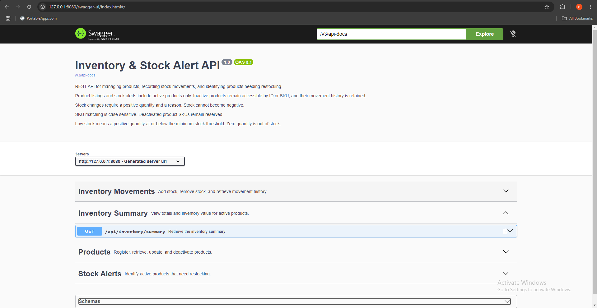

# Inventory & Stock Alert API

[](https://github.com/Antidote857/inventory-stock-alert-api/actions/workflows/ci.yml)

A Java 21 and Spring Boot REST API for managing products, recording inventory movements, and identifying products that need restocking.

Built as a backend portfolio project, it uses PostgreSQL for persistence, Flyway for database migrations, and optimistic locking to protect stock updates from concurrent changes.

## API Preview

Interactive Swagger documentation for products, stock movements, alerts, and inventory summaries.



## Features

- Register products with unique SKUs.
- Retrieve products by ID or SKU.
- Search active products by name and filter by category.
- Update product details without changing SKU or stock quantity.
- Deactivate products while preserving inventory history.
- Add and remove stock with a required reason.
- Prevent negative stock and integer overflow.
- Record initial stock and subsequent inventory movements.
- Identify low-stock and out-of-stock products.
- Calculate inventory totals and value.
- Validate requests and return consistent JSON errors.
- Explore endpoints through Swagger UI.

## Technology Stack

| Component | Technology |
|---|---|
| Language | Java 21 |
| Framework | Spring Boot 4.1.1 |
| Persistence | Spring Data JPA / Hibernate |
| Database | PostgreSQL |
| Migrations | Flyway |
| Build | Maven Wrapper |
| API documentation | springdoc-openapi 3.1.1 / Swagger UI |
| Testing | JUnit Jupiter, Mockito, MockMvc |

Development and integration testing were performed with PostgreSQL 18.

## Architecture

The application separates HTTP handling, business operations, and persistence:

- `controller`: REST endpoints and OpenAPI annotations.
- `service`: business operations and transaction boundaries.
- `repository`: database queries.
- `entity`: persisted products and inventory movements.
- `dto`: request validation and API response models.
- `exception`: business exceptions and consistent error handling.
- `enums`: stock statuses and movement types.
- `config`: OpenAPI configuration.

Database migrations are located in `src/main/resources/db/migration`.

## Business Rules

### Products

- Product names and SKUs cannot be blank.
- SKUs are unique and case-sensitive.
- SKUs cannot be changed after creation.
- Deactivated products retain their SKUs.
- Unit prices, stock quantities, and minimum stock thresholds cannot be negative.
- Unit prices support up to two decimal places.
- Default listings, searches, alerts, and summaries include active products only.
- Retrieval by ID or SKU includes inactive products.
- Product updates cannot change stock quantity.
- Description and category are optional. Omitting them in a product update clears their values.
- Inactive products may have their descriptive details updated.

### Stock Movements

- Movement quantity must be greater than zero.
- A nonblank reason is required.
- Only active products can receive stock movements.
- Stock cannot be reduced below zero.
- Product quantity and its movement record are saved in one transaction.
- Positive stock at registration creates an `INITIAL_STOCK` movement.
- Zero stock at registration does not create a movement.
- Movement history is returned newest first, with movement ID breaking timestamp ties.

Movement types:

| Type | Meaning |
|---|---|
| `INITIAL_STOCK` | Opening stock recorded during registration |
| `STOCK_IN` | Stock added |
| `STOCK_OUT` | Stock removed |

### Stock Status

| Status | Condition |
|---|---|
| `IN_STOCK` | Quantity is greater than minimum stock |
| `LOW_STOCK` | Quantity is positive and at or below minimum stock |
| `OUT_OF_STOCK` | Quantity is zero |

### Concurrency

Products have a JPA `@Version` field.

When competing transactions update the same product version, one can succeed while the other fails with an optimistic-lock conflict. The API maps that conflict to HTTP `409` with the code `CONCURRENT_UPDATE`.

Clients should reload the product and reassess the operation before retrying.

## Prerequisites

- JDK 21.
- PostgreSQL running locally.
- Git.
- Internet access for the initial Maven dependency download.

A separate Maven installation is not required because the repository includes the Maven Wrapper.

The commands below use Windows PowerShell.

## Local Setup

### 1. Clone the Repository

```powershell
git clone https://github.com/Antidote857/inventory-stock-alert-api.git
Set-Location inventory-stock-alert-api
```

Run subsequent Maven commands from the folder containing `pom.xml` and `mvnw.cmd`.

### 2. Create the Development Database

Connect as a PostgreSQL administrator. Adjust the executable path if your installation differs.

```powershell
& "C:\Program Files\PostgreSQL\18\bin\psql.exe" -h localhost -p 5432 -U postgres -d postgres
```

Inside `psql`:

```sql
CREATE ROLE inventory_app LOGIN;
```

Set the role password interactively:

```text
\password inventory_app
```

Create the database:

```sql
CREATE DATABASE inventory_db OWNER inventory_app;
```

Exit:

```text
\q
```

These creation commands are for a fresh installation. Existing users should reuse their configured role and database.

### 3. Set the Development Password

In the PowerShell terminal that will start the application:

```powershell
$inventoryPassword = Read-Host "Enter inventory_app database password" -AsSecureString
$env:DB_PASSWORD = [System.Net.NetworkCredential]::new("", $inventoryPassword).Password
```

This environment variable lasts for the current terminal session.

Configuration:

| Variable | Default |
|---|---|
| `DB_URL` | `jdbc:postgresql://localhost:5432/inventory_db` |
| `DB_USERNAME` | `inventory_app` |
| `DB_PASSWORD` | Required |

Do not commit database passwords.

### 4. Start the Application

```powershell
.\mvnw.cmd spring-boot:run
```

Flyway applies pending migrations automatically. Hibernate validates the entity mappings against the schema.

The application listens at:

```text
http://127.0.0.1:8080
```

Keep the terminal running while using the API. Press `Ctrl+C` to stop it.

## API Documentation

With the application running:

- [Swagger UI](http://127.0.0.1:8080/swagger-ui.html)
- [OpenAPI JSON](http://127.0.0.1:8080/v3/api-docs)

Swagger includes request examples, endpoint descriptions, and response schemas.

The **Execute** button sends real requests. POST, PUT, and PATCH operations can change development database records.

## API Endpoints

### Products

| Method | Endpoint | Purpose |
|---|---|---|
| POST | `/api/products` | Register a product |
| GET | `/api/products` | List active products |
| GET | `/api/products?category=Electronics` | Filter active products by category |
| GET | `/api/products/{id}` | Retrieve a product by ID |
| GET | `/api/products/sku/{sku}` | Retrieve a product by SKU |
| GET | `/api/products/search?name=mouse` | Search active products by name |
| PUT | `/api/products/{id}` | Update product details |
| PATCH | `/api/products/{id}/deactivate` | Deactivate a product |

### Inventory

| Method | Endpoint | Purpose |
|---|---|---|
| POST | `/api/inventory/{productId}/add` | Add stock |
| POST | `/api/inventory/{productId}/remove` | Remove stock |
| GET | `/api/inventory/{productId}/movements` | Retrieve movement history |
| GET | `/api/inventory/summary` | Retrieve inventory totals |

### Alerts

| Method | Endpoint | Purpose |
|---|---|---|
| GET | `/api/alerts` | All active products needing restocking |
| GET | `/api/alerts/low-stock` | Positive stock at or below the minimum |
| GET | `/api/alerts/out-of-stock` | Active products with zero stock |

## Example Workflow

Open a second PowerShell terminal while the application runs.

### Register a Product

Use a SKU that does not already exist:

```powershell
$baseUrl = "http://127.0.0.1:8080"

$productBody = @{
    name = "Wireless Keyboard"
    sku = "DEMO-KEYBOARD-001"
    description = "Compact wireless keyboard"
    category = "Computer Accessories"
    unitPrice = 399.99
    quantity = 20
    minimumStock = 5
} | ConvertTo-Json

$product = Invoke-RestMethod `
    -Uri "$baseUrl/api/products" `
    -Method Post `
    -ContentType "application/json" `
    -Body $productBody

$product | ConvertTo-Json -Depth 5
$productId = $product.id
```

Successful creation returns HTTP `201` and a `Location` header.

Repeating this request with the same SKU returns HTTP `409`.

### Add Stock

```powershell
$stockBody = @{
    quantity = 10
    reason = "Supplier delivery"
} | ConvertTo-Json

Invoke-RestMethod `
    -Uri "$baseUrl/api/inventory/$productId/add" `
    -Method Post `
    -ContentType "application/json" `
    -Body $stockBody |
    ConvertTo-Json -Depth 5
```

If run once after registration, stock increases from 20 to 30.

### Remove Stock

```powershell
$stockBody = @{
    quantity = 26
    reason = "Customer order fulfilled"
} | ConvertTo-Json

Invoke-RestMethod `
    -Uri "$baseUrl/api/inventory/$productId/remove" `
    -Method Post `
    -ContentType "application/json" `
    -Body $stockBody |
    ConvertTo-Json -Depth 5
```

If run once after the addition, stock decreases to 4 and the product becomes `LOW_STOCK`.

### View Alerts and Movement History

```powershell
curl.exe -sS "$baseUrl/api/alerts/low-stock"
```

```powershell
Invoke-RestMethod "$baseUrl/api/inventory/$productId/movements" |
    ConvertTo-Json -Depth 5
```

### View the Summary

```powershell
Invoke-RestMethod "$baseUrl/api/inventory/summary" |
    ConvertTo-Json -Depth 5
```

Inventory value is the sum of `unitPrice × quantity` for active products. Low-stock and out-of-stock counts do not overlap.

## Error Responses

Errors use a shared JSON structure:

```json
{
  "timestamp": "2026-10-20T16:10:00Z",
  "status": 400,
  "error": "VALIDATION_ERROR",
  "message": "One or more fields are invalid.",
  "path": "/api/products",
  "fieldErrors": {
    "name": [
      "Product name is required."
    ]
  }
}
```

Common errors:

| HTTP status | Error code | Meaning |
|---|---|---|
| 400 | `VALIDATION_ERROR` | Invalid request fields |
| 400 | `INVALID_REQUEST_BODY` | Missing or malformed JSON, or invalid field types |
| 400 | `INVALID_PRODUCT_ID` | Product ID is not positive |
| 400 | `STOCK_LIMIT_EXCEEDED` | Addition would exceed the supported stock limit |
| 404 | `PRODUCT_NOT_FOUND` | Product does not exist |
| 409 | `DUPLICATE_SKU` | SKU is already reserved |
| 409 | `INSUFFICIENT_STOCK` | Removal exceeds available stock |
| 409 | `PRODUCT_INACTIVE` | Stock operation targets an inactive product |
| 409 | `CONCURRENT_UPDATE` | Another transaction changed the product |
| 409 | `DATA_CONFLICT` | A database integrity constraint rejected the operation |
| 500 | `INTERNAL_SERVER_ERROR` | Unexpected application failure |

## Continuous Integration

GitHub Actions builds the application and runs the test suite on pushes to
`main` and pull requests targeting `main`.

Each run uses Java 21 and a temporary PostgreSQL 18 database. The workflow
runs `clean verify` through the Maven Wrapper.

Workflow configuration: [ci.yml](.github/workflows/ci.yml).

## Automated Tests

The suite currently contains 49 tests:

| Test class | Tests |
|---|---:|
| ProductTest | 15 |
| InventoryMovementTest | 17 |
| InventoryStockAlertApiApplicationTests | 1 |
| InventoryIntegrationTest | 7 |
| InventoryConcurrencyTest | 1 |
| ApiControllerTest | 8 |
| **Total** | **49** |

Coverage includes:

- Stock-status boundaries.
- Valid and invalid stock changes.
- Integer overflow protection.
- Inactive-product restrictions.
- Movement arithmetic and required fields.
- Product and movement persistence.
- Rollback after a flushed stock update.
- Competing stock removals.
- HTTP validation and error responses.

This is a test count, not a claim of complete code coverage.

### Create the Test Database

Connect as the PostgreSQL administrator:

```powershell
& "C:\Program Files\PostgreSQL\18\bin\psql.exe" -h localhost -p 5432 -U postgres -d postgres
```

Inside `psql`:

```sql
CREATE ROLE inventory_test_app LOGIN;
```

```text
\password inventory_test_app
```

```sql
CREATE DATABASE inventory_test_db OWNER inventory_test_app;
```

```text
\q
```

### Set the Test Password

```powershell
$inventoryTestPassword = Read-Host "Enter inventory_test_app password" -AsSecureString
$env:TEST_DB_PASSWORD = [System.Net.NetworkCredential]::new("", $inventoryTestPassword).Password
```

The test profile uses `inventory_test_db` and `inventory_test_app`.

### Run All Tests

```powershell
.\mvnw.cmd test
```

PostgreSQL must be running. Integration tests create unique test products and clean up their own records.

### Run Tests That Do Not Need PostgreSQL

```powershell
.\mvnw.cmd "-Dtest=ProductTest,InventoryMovementTest,ApiControllerTest" test
```

Expected: 40 tests.

MockMvc tests use mocked services. Database integration tests separately verify persistence and transaction behaviour.

## Build an Executable JAR

With the test database available and `TEST_DB_PASSWORD` set:

```powershell
.\mvnw.cmd clean package
```

With `DB_PASSWORD` set, start the packaged application:

```powershell
java -jar .\target\inventory-stock-alert-api-0.0.1-SNAPSHOT.jar
```

Stop any existing application instance first to free port 8080.

## Troubleshooting

### Password authentication failed

Check which database user appears in the error:

- `inventory_app` uses `DB_PASSWORD`.
- `inventory_test_app` uses `TEST_DB_PASSWORD`.

Set the appropriate environment variable in the same terminal where Maven runs. Variables set this way do not persist after closing the terminal.

### Maven Wrapper is not recognized

Confirm you are in the folder containing `pom.xml` and `mvnw.cmd`.

```powershell
Get-ChildItem
```

### Port 8080 is already in use

Stop the existing application with `Ctrl+C` before starting another instance.

### Swagger UI does not open

Confirm the application has finished starting, then visit:

```text
http://127.0.0.1:8080/swagger-ui.html
```

### Failed to load ApplicationContext

Read the earlier `Caused by:` lines in the console or the reports under `target/surefire-reports`. The final Maven summary alone usually does not identify the root cause.

## Version 1 Scope and Limitations

- Single business location.
- Backend API only.
- No authentication or authorization.
- Local configuration binds to `127.0.0.1`.
- Stock alerts are retrieved through API requests; no email or SMS notifications.
- No permanent product-deletion endpoint.
- No product-reactivation endpoint.
- Product lists and movement history are not paginated.
- Summary calculations load active products into memory.
- Inventory values use one assumed currency; no currency conversion.
- No public production deployment is configured.

Authentication, deployment configuration, and operational hardening are required before exposing the API publicly.

## Potential Improvements

- Pagination and sorting options.
- Database aggregate queries for summary calculations.
- Authentication and role-based access.
- Containerized development and test environments.
- Additional integration tests for reporting and lifecycle operations.
- A frontend dashboard.
- Multi-location inventory support.